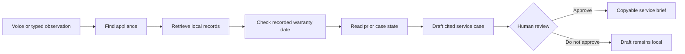

# Latchbook

**From “the washer is leaking again” to a cited, approval-first service brief.**

Latchbook is a local, voice-first home service agent built for the Alexa+ track of the 2026 Amazon Developer Hackathon. It has a real Model Context Protocol (MCP) Streamable HTTP endpoint implementing protocol version `2025-11-25`, plus an independent web simulator that shows the same tool workflow. It does **not** claim to be a deployed Alexa+ add-on or to use gated Alexa+ developer tools.

The agent identifies an appliance, retrieves relevant home records, checks the recorded warranty date, reviews case history, and drafts a service case. A human must explicitly approve before the brief is marked shareable. Nothing is sent, booked, purchased, or changed outside this local application.

## Why this is more than Q&A

The product addresses the messy moment *before* service: people repeat a problem without the model number, prior incident, manual warning, or warranty context. A generic chatbot can answer a question; Latchbook keeps a persistent local repair history and turns a spoken observation into a sourced, reviewable handoff.

The simulator's natural-language router is intentionally narrow and deterministic—no paid model or hidden cloud service. The actual Alexa+-track integration is the MCP server, whose tools can be discovered and invoked by a compatible MCP client. The simulator demonstrates the intended voice + visual experience without pretending to be the restricted Alexa+ preview toolkit.

## At a glance

| Capability | Implementation |
|---|---|
| Alexa+ track technology | Self-hosted MCP Streamable HTTP endpoint using protocol `2025-11-25` |
| Agent workflow | Five sequential tool calls from appliance identification to persistent case draft |
| Available tools | Eight discoverable MCP tools with JSON Schema inputs and structured output |
| Memory | Persistent household records, service cases, approval state, and event history |
| Provenance | Every case carries record IDs, excerpts, and a visible tool trail |
| Human control | Speech or text cannot approve a case; the export route also enforces approval |
| Cost | No API key, runtime dependency, account, cloud service, or physical device |
| Verification | Eleven automated protocol, security, persistence, and workflow tests |

## How the workflow fits together



This is deliberately a handoff workflow rather than an automated repair or marketplace flow. The agent compiles what the household knows, preserves uncertainty, and stops at the point where a person should decide what happens next.

## Tool catalogue

| Tool | Purpose | Effect |
|---|---|---|
| `find_appliance` | Resolve a household appliance by name, kind, or model | Read only |
| `search_home_records` | Retrieve relevant manual, warranty, incident, and user-note evidence | Read only |
| `check_warranty` | Compare today with the locally recorded warranty end date | Read only; never decides coverage |
| `list_service_cases` | Read persistent draft, approved, and closed cases | Read only |
| `draft_service_case` | Create a case using an observed symptom and valid record IDs | Local state only |
| `approve_service_case` | Mark a reviewed draft ready to copy | Requires explicit human confirmation |
| `close_service_case` | Save the user-provided resolution of an approved case | Requires explicit human confirmation |
| `add_home_record` | Add a user-provided plain-text note for later retrieval | Local state only |

## Why the approval boundary matters

Latchbook deals with information that can affect safety, service costs, and warranty expectations. It therefore separates three kinds of information:

- **Observed:** what the person says happened.
- **Recorded:** what a local manual excerpt, note, date, or prior incident says.
- **Verified:** what a qualified provider would still need to confirm.

The agent never converts recorded information into a diagnosis or coverage promise. It cannot approve a case from a spoken phrase, and the server refuses to export a draft even if someone bypasses the visible interface.

## Run at zero software cost

Requires Node.js 22 or newer. No `npm install` is necessary because the application has no runtime dependencies.

```bash
npm start
```

Open <http://127.0.0.1:8787>. The server binds to localhost only. Typed input works in every modern browser; voice input uses the browser's Speech Recognition API when available. All sample appliance names and documents are fictional. You can paste a user-owned plain-text note to demonstrate live retrieval beyond the seed records.

```bash
npm test
```

The tests verify MCP initialization, tool discovery and invocation, strict local-origin/version handling, the five-tool agent sequence, persistence, citations, warranty caveats, approval gating, and user-added record retrieval.

### Test coverage

The suite exercises the real HTTP server and isolated temporary data stores. It verifies:

- MCP `2025-11-25` negotiation, initialization notification, tool discovery, and tool calls.
- Local `Host`, `Origin`, content type, `Accept`, and protocol-version enforcement.
- The same persistent workflow through the simulator API.
- Five-step orchestration with cited evidence.
- Approval-gated export and protection against double approval.
- Warranty-date caveats without coverage promises.
- Retrieval of newly added user records.
- Cross-turn case memory and explicit reset behavior.
- Duplicate-draft prevention for repeated reports.
- Refusal of external booking/contact requests without state mutation.
- Rejection of evidence belonging to a different appliance.

## MCP connection

- Endpoint: `http://127.0.0.1:8787/mcp`
- Transport: Streamable HTTP, JSON-RPC 2.0, JSON response mode (no SSE stream)
- Protocol version: `2025-11-25`
- State: stateless MCP transport; household case data persists in `data/home.json`
- Supported methods: `initialize`, `notifications/initialized`, `ping`, `tools/list`, `tools/call`
- Tools: `find_appliance`, `search_home_records`, `check_warranty`, `list_service_cases`, `draft_service_case`, `approve_service_case`, `close_service_case`, `add_home_record`

The server requires both `application/json` and `text/event-stream` in the MCP POST `Accept` header, accepts the protocol-version header after initialization, returns 202 for the initialized notification, and returns 405 for GET because it does not offer SSE. It validates local `Host` and `Origin` headers; it is **not** a publicly hosted multi-user service.

## Reliability and local security

- The HTTP server binds to `127.0.0.1` rather than all network interfaces.
- Local host and same-origin checks reduce cross-origin and DNS-rebinding risk.
- Requests are JSON-only and capped at 32 KB.
- Static responses include a restrictive Content Security Policy, no-referrer policy, and MIME sniffing protection.
- Store mutations are serialized, written to a temporary file, and atomically renamed.
- Runtime household data and environment files are excluded from Git.
- Sample appliances, documents, incidents, and dates are explicitly fictional.

See [architecture](docs/ARCHITECTURE.md) for the trust boundary and [hackathon audit](docs/HACKATHON_AUDIT.md) for exact submission requirements.

## Demo path

1. Choose **The washer is leaking again**. Watch the five real tool steps and the citations to a fictional manual and prior incident.
2. Inspect the recorded warranty caveat and draft-only state. Ask **What is the washer case status?** to prove memory across turns.
3. Click **Review & approve brief**, type the human approver's name, then copy the service brief. Nothing is sent externally.
4. Add a plain-text note, ask about the appliance again, and observe the note appearing as a citable record.
5. Try **The dishwasher will not drain** to demonstrate a second appliance with a different recorded warranty status.

## Repository map

```text
src/seed.mjs        Fictional demo appliances and records
src/store.mjs       Atomic local JSON persistence
src/tools.mjs       The eight domain/MCP tools
src/agent.mjs       Multi-step simulator orchestrator and brief builder
src/mcp.mjs         MCP 2025-11-25 JSON-RPC lifecycle and tool dispatch
server.mjs          Local HTTP app, simulator routes, and /mcp endpoint
public/             Responsive voice/text/visual simulator
test/               Protocol and workflow tests
```

## Boundaries and next steps

- This prototype does not ingest PDFs or run OCR; user-added records are plain text only.
- Warranty status is a comparison with a stored date, **not** an actual coverage determination.
- Manual excerpts are fictional; they are not real manufacturer instructions or a substitute for a qualified professional.
- The browser speech API is optional and browser-dependent. The typed path is fully functional.
- No contractor marketplace, calendar, email, or Alexa production account is connected. The brief is for a human to review and share.
- A production version would need authentication, household isolation, encryption, consent controls, real integrations, and provider verification before remote hosting.

## License

MIT © 2026 Rehan Raza
